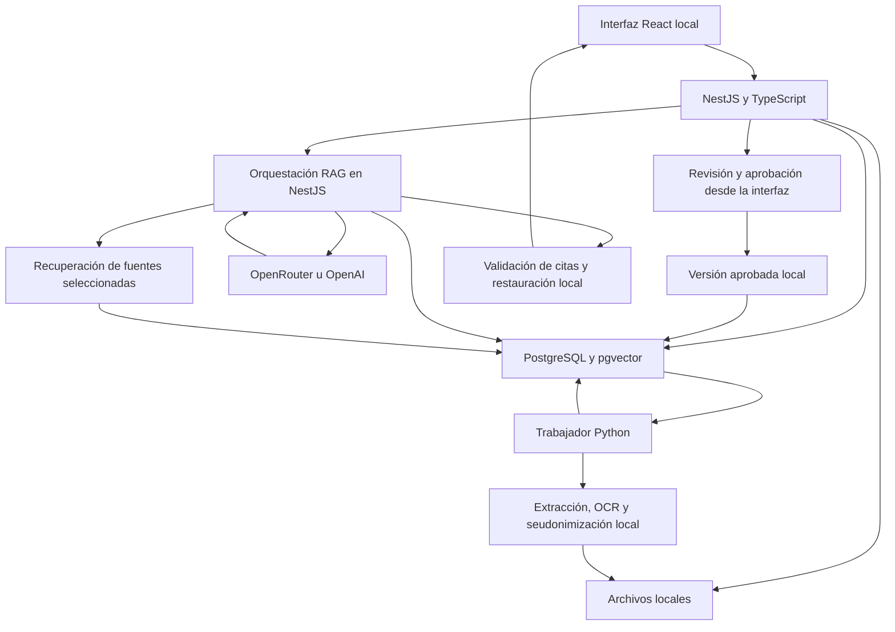

# Arquitectura — DocuExtractoChat

Fecha: 2026-10-09  
Estado: propuesta documentada; pendiente de aclaraciones y validación técnica.  
La fase 1 de previsualización local está implementada. La arquitectura RAG completa descrita aquí continúa pendiente; NestJS, Python y PostgreSQL todavía no se han inicializado.

## 1. Arquitectura general

Aplicación web personal accesible únicamente desde el equipo. NestJS con TypeScript sirve la única API HTTP y, en la distribución local, la interfaz React compilada. NestJS administra conversaciones, proveedores, recuperación, segmentación con LLM, embeddings y síntesis. Un trabajador Python independiente realiza extracción, OCR y detección/sustitución de datos sensibles, sin exponer otra API HTTP. Ambos coordinan tareas mediante una cola persistente en PostgreSQL. Los archivos se guardan en disco local; únicamente NestJS realiza llamadas a proveedores externos sobre contenido autorizado.

La distribución completa utiliza contenedores Linux con Docker Compose. Los archivos locales y PostgreSQL persisten en volúmenes del equipo. Cada componente se conteneriza en la fase que lo incorpora. El desarrollo puede usar ejecución nativa, pero el cierre de cada fase valida también su distribución Docker.

Esta decisión sustituye la propuesta anterior de FastAPI como backend principal. Python se conserva para las herramientas documentales.

## 2. Tecnologías propuestas

| Responsabilidad | Tecnología |
|---|---|
| API y orquestación RAG | NestJS, TypeScript, Node.js LTS compatible |
| Trabajador documental | Python 3.12, Pydantic para contratos internos, Psycopg para la cola |
| Interfaz | React, TypeScript, Vite |
| Persistencia y migraciones | PostgreSQL, pgvector, TypeORM y migraciones SQL administradas desde NestJS |
| Extracción y tablas | Docling con RapidOCR, CPU |
| Detección y sustitución de datos | Presidio, reconocimiento local en español e inglés, reglas y revisión manual |
| Distribución local | Docker Compose, imágenes por componente y volúmenes persistentes |
| Pruebas | Jest y Supertest para NestJS; pytest para Python; PostgreSQL de pruebas y pruebas de navegador |

Evitar servicios adicionales de cola o caché para esta escala. El presupuesto de memoria requiere un solo trabajo de extracción activo. El perfil económico propone hasta dos hilos de CPU, 3 GiB para todo el contenedor Python y un umbral preventivo de 2,5 GiB para el subproceso pesado, dejando margen al supervisor y a tareas breves. Estos valores sustituyen el límite previo de 3 GB para el subproceso y deben medirse. Un exceso de memoria debe finalizar controladamente el subproceso y conservar checkpoints; la recuperación de leases cubre también un cierre inesperado del contenedor.

TypeORM será el propietario único del esquema y las migraciones, incluidas la extensión vector y las consultas SQL específicas de recuperación y cola. No utilizar SQLAlchemy/Alembic ni sincronización automática del esquema. Python consume el esquema existente mediante contratos internos y permisos limitados; no crea ni modifica tablas.

## 3. Límites y contratos de módulos

- **Biblioteca (NestJS):** carga, validación de formato, sensibilidad, hash, archivos y eliminación.
- **Extracción (Python):** produce bloques ordenados, texto, tablas y procedencia sin llamar a proveedores externos.
- **Privacidad (NestJS + Python):** Python detecta entidades y prepara sustituciones; NestJS administra correspondencias confirmadas, revisión, aprobación y control de salida hacia proveedores.
- **Proveedores (NestJS):** encapsula capacidades, generación, embeddings, imágenes, errores, consumo y streaming.
- **Ingesta (NestJS):** segmenta copias autorizadas y publica índices completos de forma coherente.
- **Recuperación (NestJS):** filtra fuentes/versiones, combina búsqueda semántica y textual y prepara evidencia.
- **Conversaciones (NestJS):** conserva contexto seudonimizado, valida citas y restaura nombres para presentación local.
- **Trabajos (NestJS + Python):** NestJS administra la cola y ejecuta tareas de proveedores; Python reclama únicamente tareas documentales locales. Ambos usan leases, cancelación, checkpoints y recuperación de tareas abandonadas.

Los contratos deben identificar documento, versión y bloques de procedencia. Ningún módulo de proveedor tendrá acceso directo a los originales o a la tabla de correspondencias.

### Comunicación interna

Usar trabajos PostgreSQL tipados y contratos JSON versionados, validados en TypeScript y Python. Los trabajos transportan identificadores internos y referencias a artefactos locales; el texto extenso y las imágenes permanecen en los artefactos. Python publica resultados y checkpoints del trabajo, y NestJS valida esos resultados antes de incorporarlos a una versión documental.

Las preguntas que requieren detección de datos sensibles pasan por una tarea local Python antes de generar embeddings o prompts. Priorizar esas tareas breves sobre extracciones pendientes y ejecutar el OCR pesado en un subproceso controlado, para no bloquear el análisis de preguntas durante un documento largo. El trabajo devuelve datos/entidades detectadas; NestJS resuelve correspondencias y decide si es necesario pedir revisión.

Solo el módulo de privacidad de NestJS construye el contenido autorizado de salida. Los adaptadores de proveedores reciben ese contenido y su referencia de aprobación, sin leer originales o correspondencias. Python no recibe claves de proveedores ni realiza llamadas a sus APIs.

## 4. Proveedores

### OpenRouter

Predeterminado con endpoints gratuitos explícitos. Candidatos iniciales publicados durante la planificación:

- Segmentación, chat y apoyo visual: `google/gemma-4-26b-a4b-it:free`.
- Embeddings: `nvidia/nemotron-3-embed-1b:free`.

Comprobar precio, disponibilidad, capacidades y condiciones antes del uso; la etiqueta del modelo por sí sola no sustituye esa comprobación. Los endpoints gratuitos pueden cambiar o limitar solicitudes. Algunas condiciones de proveedores restringen contenido sensible: la aprobación local no garantiza que una copia cumpla sus condiciones si conserva identificadores indirectos.

### OpenAI

Adaptador separado mediante Responses API para generación y Embeddings API para vectores. Inicialmente desactivado. Requiere clave, selección de modelos compatibles y activación explícita del uso de pago por el usuario.

### Configuración común

Cada función configura proveedor y modelo por separado. Los adaptadores residen en NestJS. Guardar claves exclusivamente en configuración del servidor NestJS local; no exponerlas al navegador, al trabajador Python ni en logs. Registrar consumo y estimaciones cuando haya precios disponibles, sin prometer un tope estricto de facturación.

No ejecutar fallback automático entre proveedores. Si un modelo no está disponible, conservar el trabajo y requerir reintento o cambio explícito. Un cambio de embeddings nunca es un simple fallback: exige otro índice compatible.

## 5. Flujo de ingesta

1. Validar archivo, declarar sensibilidad, calcular hash y guardar el original con identificador interno. Defaults iniciales: 50 MB y 200 páginas.
2. Extraer localmente por páginas, conservando orden, encabezados, unidades, tablas y regiones. Archivos protegidos, ilegibles o sin contenido utilizable reciben un error visible y recuperable cuando sea posible.
3. Marcar páginas o tablas dudosas para revisión. No habilitar el documento para consultas hasta aprobar su extracción.
4. Para archivos sensibles, generar sustituciones locales y revisar texto e imágenes. Aprobar una versión exacta; cualquier modificación posterior revoca esa aprobación.
5. El apoyo visual externo solo recibe material aprobado. En archivos sensibles, usar imágenes rasterizadas con ocultaciones irreversibles, sin capas de texto o metadatos originales. Su resultado vuelve a revisión antes de reutilizarlo externamente.
6. Pedir al LLM una segmentación referida a bloques numerados. El modelo identifica límites, títulos y agrupaciones; la evidencia se construye desde el texto aprobado, no desde una paráfrasis del modelo.
7. Validar cobertura, orden y referencias. Conservar tablas completas cuando quepan; dividir las extensas por filas repitiendo encabezados y unidades y conservando notas relevantes.
8. Generar embeddings en lotes compatibles con el modelo y registrar cada etapa. Publicar la versión indexada solo cuando sus fragmentos estén completos.

Si el LLM no está disponible, el documento espera; no publicar un índice provisional de fragmentación por reglas.

## 6. Seudonimización reversible

La correspondencia local contiene identificadores estables de entidades, nombres y variantes confirmadas. Las empresas se representan como `EMPRESA_001`, las personas como `PERSONA_001` y otros datos mediante identificadores tipados. Elegir una sintaxis reservada y tratar el contenido original que coincida con ella como texto literal, evitando colisiones.

NestJS conserva y administra las correspondencias. Python devuelve candidatos y propuestas de sustitución; NestJS asigna identificadores estables a entidades confirmadas y proporciona al trabajador únicamente las sustituciones necesarias para preparar cada copia local.

El usuario revisa empresas, personas, identificaciones, correos, teléfonos y direcciones. No unir automáticamente entidades ambiguas entre archivos. Las funciones y roles documentales —emisor, destinatario, persona de contacto— pertenecen a la evidencia, no se deducen solo por compartir un nombre.

### Salida hacia proveedores

- Solo contenido de versiones aprobadas, incluidas tablas, etiquetas y metadatos.
- Preguntas e historial se transforman localmente antes de generar vectores o prompts.
- La detección de datos nuevos o ambiguos bloquea el envío hasta su revisión.
- Nunca incluir correspondencias, originales, imágenes originales sensibles o rutas con datos identificativos.

### Restauración en pantalla

- Conservar la respuesta canónica y el contexto del modelo con seudónimos.
- Resolver localmente solo identificadores conocidos y permitidos por las fuentes de esa respuesta.
- No restaurar identificadores inventados o provenientes de documentos ajenos a la conversación.
- Mantener separación entre representación canónica y presentación. El texto restaurado nunca vuelve al modelo sin pasar de nuevo por el control de salida.
- Escapar texto al mostrarlo; los nombres restaurados no son HTML ejecutable.

Las citas de una copia seudonimizada deben mantener correspondencia con páginas/regiones originales. El visor local puede mostrar el original al usuario, sin incorporarlo a solicitudes externas.

## 7. Persistencia y búsqueda

Entidades de persistencia previstas:

- Documentos y archivos locales.
- Versiones extraídas/aprobadas e información de revisión.
- Bloques, tablas, páginas y procedencia.
- Entidades, variantes y correspondencias locales.
- Fragmentos e índices de embeddings.
- Conversaciones, selección de fuentes, mensajes y citas.
- Trabajos, checkpoints y consumo de proveedores.

Habilitar `CREATE EXTENSION vector`. Cada índice registra proveedor, modelo, dimensión y parámetros que afecten a los vectores. Comprobar dimensiones al escribir y consultar. La dimensión real se valida al configurar el modelo, no se presupone por el nombre del proveedor.

Las búsquedas utilizan exclusivamente fragmentos seudonimizados de versiones aprobadas y documentos seleccionados. Combinar similitud vectorial exacta y búsqueda textual PostgreSQL mediante RRF, recuperando contexto adyacente cuando corresponda. Evaluar índices aproximados solo si las mediciones justifican su complejidad.

Un cambio del modelo de embeddings crea una generación de índice separada; activarla al completar la reindexación. Las consultas usan el modelo de esa generación, aunque el chat tenga otro proveedor.

## 8. Conversaciones y cobertura completa

Persistir la selección de documentos y las versiones usadas por cada respuesta. Producir texto, referencias a evidencia y avisos de cobertura. Validar que las citas existen y pertenecen al conjunto autorizado.

Las preguntas puntuales usan recuperación híbrida. Los resúmenes completos y comparaciones globales recorren todas las secciones seleccionadas, generan resultados parciales cacheados por versión/configuración y luego sintetizan. No presentar una selección de fragmentos como un resumen exhaustivo.

Indicar evidencia insuficiente, contradicciones y cobertura incompleta. Tratar instrucciones dentro de documentos como contenido no confiable, no como órdenes del sistema.

## 9. API e interfaz previstas

- Documentos: cargar, listar, consultar estado, revisar, aprobar, reintentar y eliminar.
- Privacidad: editar sustituciones, confirmar identidades, gestionar ocultaciones y consultar correspondencias localmente.
- Conversaciones: crear, listar, seleccionar fuentes, enviar mensajes e historial.
- Trabajos: progreso, cancelación y reanudación.
- Configuración: proveedores, capacidades, modelos, claves y habilitación del pago.
- Evidencia: abrir páginas/secciones y mostrar citas locales.

Usar SSE para eventos de respuestas y progreso. Para respuestas que deban validarse antes de mostrarse, transmitir estado de generación y publicar el contenido final después de validar citas e identificadores; no exponer texto sin validar como si ya fuera definitivo.

La interfaz incluye biblioteca, conversaciones, chat, visor, revisión de extracción/privacidad y configuración. La distribución local sirve la interfaz compilada desde NestJS; los servidores separados son herramientas de desarrollo. Python no expone endpoints al navegador: NestJS obtiene sus resultados de la cola y publica el estado mediante su API/SSE.

## 10. Operación y ciclo de vida

- Servicios ligados al equipo local; sin acceso público ni autenticación multiusuario en esta versión.
- Cola PostgreSQL con un trabajador de extracción y checkpoints por etapa/página/lote.
- Consumidores separados por tipo de trabajo: Python para procesamiento local y NestJS para llamadas externas y síntesis. Reclamar trabajos transaccionalmente, con leases y claves de idempotencia, sin Redis/BullMQ inicialmente.
- Respetar `Retry-After`, limitar reintentos transitorios y mostrar espera por cuota cuando no sea posible continuar.
- Recuperar tareas abandonadas tras reinicio sin duplicar resultados; cancelaciones dejan una etapa consistente.
- Restringir acceso local a archivos, claves y correspondencias. Evitar registrar prompts o textos reales sensibles en logs.
- Al eliminar un documento, borrar originales, derivados y vectores; marcar sus citas históricas como no disponibles.
- Conservar correspondencias mientras otros documentos las utilicen. No resolver desde referencias históricas una correspondencia eliminada.

### Distribución Docker

- `compose.yaml` será la definición de ejecución local de producción, con configuración de ejemplo sin secretos. Un override de desarrollo será independiente; no ejecutar watchers o Vite dev server en la distribución final.
- Fase 1: imagen temporal de previsualización que compila React/Vite y sirve estáticos con Nginx. Fase 2: NestJS integra esos estáticos y sustituye ese servicio; la distribución final no necesita un contenedor web adicional.
- Servicios finales persistentes: `app` (NestJS y React compilado), `worker` (Python) y `db` (PostgreSQL con pgvector). El proceso de migración usa la imagen de la aplicación como tarea de una sola ejecución, sin otra infraestructura permanente.
- Construcciones por etapas para Node, dependencias Python CPU-only y versiones fijadas compatibles con las bibliotecas. No elegir Alpine para Python si obliga a compilar dependencias pesadas o rompe compatibilidad de OCR.
- `.dockerignore` excluye secretos, archivos de usuario, correspondencias, datos de PostgreSQL, modelos descargados y artefactos locales. Nunca incluirlos en capas de imagen.
- Publicar únicamente la aplicación en una dirección local del host. PostgreSQL y Python usan la red interna; un puerto de base de datos para desarrollo, si se necesita, queda limitado al host local.
- Claves externas solo en `app`, nunca en el navegador, imágenes o trabajador. El trabajador obtiene credenciales PostgreSQL con permisos limitados y acceso a los artefactos requeridos.
- Volúmenes separados para PostgreSQL, archivos/documentos y caché de modelos locales; evitar descargas en cada arranque. Las correspondencias residen en PostgreSQL y forman parte del respaldo sensible.
- Healthchecks y dependencias: esperar base saludable, ejecutar migraciones una vez y habilitar consumidores al terminarlas correctamente. No confundir un contenedor arrancado con un servicio listo.
- Documentar inicio, parada, logs, actualización, respaldo y restauración. No eliminar volúmenes en una parada habitual. Una copia consistente pausa escrituras/trabajos y respalda conjuntamente la base y sus archivos.
- Validar Windows con Docker Desktop y contenedores Linux como primer destino, y una instalación Linux compatible como segundo destino cuando se disponga del entorno. No afirmar compatibilidad ARM64 sin construir/probar las dependencias correspondientes.

### Perfil económico y rendimiento

Valores iniciales de ejecución, ajustables después de medir:

| Componente | Presupuesto inicial de memoria |
|---|---|
| NestJS con interfaz compilada | 512 MiB |
| PostgreSQL | 512 MiB |
| Trabajador Python completo | 3 GiB |
| Total máximo agregado de contenedores | 4 GiB |
| Objetivo de uso agregado en reposo | Hasta 1,5 GiB |

El total no incluye navegador, Docker Desktop/WSL, sistema operativo ni builds. Los topes no representan consumo constante ni garantizan RAM libre para otras aplicaciones. Medir esos gastos aparte en el equipo de 8 GB antes de declarar validado el perfil. Si una biblioteca no cabe, optimizar o hacer un ajuste explícito; no subir límites ni degradar evidencia silenciosamente.

- Configurar límites de memoria y CPU verificables en Compose local, sin asumir que restricciones opcionales de un orquestador se aplican automáticamente. Inspeccionar límites efectivos del contenedor durante las pruebas.
- Limitar el OCR a un proceso pesado, hasta dos hilos y una cuota inicial de una CPU equivalente; ajustar explícitamente si los resultados justifican más capacidad. No ocupar todos los núcleos para acelerar una ingesta.
- Cargar modelos locales bajo demanda y liberarlos al terminar tareas pesadas. Conservar modelos en disco, no permanentemente en RAM. Elegir tamaños de lote de una página inicialmente.
- Priorizar análisis breve de preguntas; no cargar dos conjuntos pesados de modelos a la vez. Bajo presión del contenedor, detener el OCR en un checkpoint para atender una tarea breve o conservarla pendiente con estado visible.
- La presión de memoria del host Windows no se deduce de la memoria libre del contenedor. Si no se puede medir desde Docker, documentar comprobación en el host y mantener pausa manual disponible; no afirmar adaptación automática al host.
- Dimensionar pools de PostgreSQL y buffers para el presupuesto, paginar resultados y evitar operaciones de CPU sincrónicas sobre el event loop de NestJS. Reutilizar resultados aprobados y embeddings por versión/modelo sin duplicar trabajo.
- Usar compilación de producción de Vite; cargar conversor DOCX, visor avanzado y pantallas secundarias bajo demanda. React/Vite no sustituyen la medición de renderizado y transferencia.
- Mantener el archivo fuera del estado React cuando no se necesite copiarlo, usar URLs de objeto y lecturas parciales, y liberar recursos al cambiar de vista. Paginar biblioteca e historial; no renderizar todas las páginas de un PDF simultáneamente.
- SSE con actualizaciones de estado moderadas y sin enviar cada token como una reconstrucción completa del chat. Pausar sondeos cuando no hay trabajos y evitar bucles activos de la cola en reposo.
- Objetivo inicial: interacciones locales principales hasta 200 ms en producción con documentos representativos. Medir apertura del visor y procesamiento por separado; no incluir latencia del proveedor en este objetivo.
- Cada fase registra duración de tareas, pico de RAM, CPU, tamaño del frontend y errores. Evitar crecimiento sostenido de memoria al repetir carga/reemplazo y conversación. No introducir pruebas que fallen por pequeñas fluctuaciones: comparar muestras representativas y explicar desviaciones.
- La optimización nunca omite revisión, páginas, tablas, citas o segmentación requerida. Un documento que excede capacidad queda pendiente con explicación, posibilidad de reintento y progreso conservado.

## 11. Secuencia de desarrollo y validación

El orden operativo, alcance de cada entrega, política Git y aprobaciones se definen en [FASES.md](FASES.md). La primera entrega será la interfaz local de selección y previsualización, antes de inicializar la API o infraestructura. La lista siguiente agrupa subsistemas; no autoriza implementarlos en una sola pasada.

1. Base NestJS/React, migraciones TypeORM, extensión vector, contratos de cola con Python y adaptadores OpenRouter/OpenAI.
2. Carga en NestJS, trabajador Python de extracción/seudonimización, visor y aprobación.
3. Segmentación, embeddings y recuperación en NestJS, con trabajos reanudables.
4. Chat en NestJS con citas, detección local de datos en preguntas y restauración de nombres.
5. Resúmenes, comparaciones, evaluación e instalación documentada.

Pruebas unitarias de NestJS con Jest y proveedores simulados; API con Supertest; procesamiento Python con pytest; integración con PostgreSQL real de pruebas y recorridos de navegador. Verificar contratos JSON entre TypeScript y Python, propiedad única de migraciones, reclamación exclusiva de trabajos, propagación de cancelaciones y recuperación de leases tras reinicios. Las comprobaciones reales de API serán explícitas, no parte de la ejecución habitual de pruebas.

Evaluar PDF textual, escaneo, DOCX, tablas, español/inglés, evidencia ausente y contradictoria. Inspeccionar solicitudes para probar que no salen datos sin aprobar; comprobar nombres restaurados, ambigüedades y seudónimos inventados. Probar cuotas, reinicios, reindexación, exceso de memoria y aislamiento de fuentes. Medir recursos y calidad con archivos representativos antes de fijar expectativas de velocidad.

## 12. Referencias y decisiones pendientes

- [Docling: opciones de extracción, OCR y tablas](https://docling-project.github.io/docling/reference/pipeline_options/)
- [NestJS: integración con bases de datos](https://docs.nestjs.com/techniques/database)
- [NestJS: eventos SSE](https://docs.nestjs.com/techniques/server-sent-events)
- [NestJS: carga de archivos](https://docs.nestjs.com/techniques/file-upload)
- [TypeORM: entidades y columnas](https://typeorm.io/docs/entity/entities/)
- [Docker Compose: servicios y límites de recursos](https://docs.docker.com/reference/compose-file/services/)
- [Docker Compose: orden de arranque y salud](https://docs.docker.com/compose/how-tos/startup-order/)
- [Docker: volúmenes y respaldo](https://docs.docker.com/engine/storage/volumes/)
- [Vite: compilación de producción](https://vite.dev/guide/build.html)
- [React: carga diferida de componentes](https://react.dev/reference/react/lazy)
- [pgvector: almacenamiento y búsqueda vectorial en PostgreSQL](https://github.com/pgvector/pgvector)
- [Presidio: anonimización](https://microsoft.github.io/presidio/anonymizer/)
- [OpenRouter: candidato de generación y visión](https://openrouter.ai/google/gemma-4-26b-a4b-it:free)
- [OpenRouter: candidato de embeddings](https://openrouter.ai/nvidia/nemotron-3-embed-1b:free)
- [OpenAI: generación](https://developers.openai.com/api/docs/guides/text)
- [OpenAI: embeddings](https://developers.openai.com/api/docs/guides/embeddings)
- [OpenAI: precios](https://developers.openai.com/api/docs/pricing)

Las referencias se consultaron durante la planificación; no se han comprobado cuentas, cuotas ni llamadas reales. Las versiones de dependencias se fijarán durante la preparación de implementación tras verificar compatibilidad.

El usuario eligió NestJS como backend principal y autorizó posteriormente la fase 1: React/Vite y un servidor estático Nginx temporal en Docker. Su resultado se registra en [FASE-01-RESULTADOS.md](FASE-01-RESULTADOS.md). Las fases siguientes necesitan autorización expresa; este documento no autoriza por sí solo su implementación.
